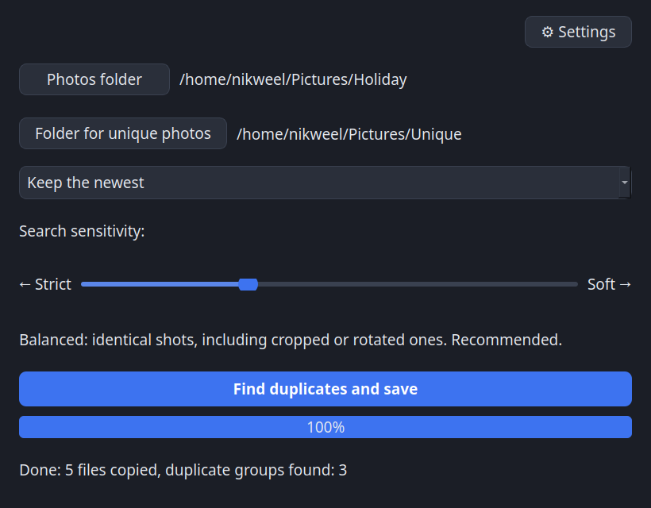

# Photo Duplicate Finder AI

[العربية](README.ar.md) · [Български](README.bg.md) · [中文（简体）](README.zh.md) · [繁體中文](README.zh-TW.md) · [Hrvatski](README.hr.md) · [Čeština](README.cs.md) · [Dansk](README.da.md) · [Nederlands](README.nl.md) · [English](README.md) · [Suomi](README.fi.md) · [Français](README.fr.md) · [Deutsch](README.de.md) · [Ελληνικά](README.el.md) · [हिन्दी](README.hi.md) · [Magyar](README.hu.md) · [Bahasa Indonesia](README.id.md) · [Italiano](README.it.md) · [日本語](README.ja.md) · [한국어](README.ko.md) · [Lietuvių](README.lt.md) · [Norsk](README.nb.md) · [Polski](README.pl.md) · [Português](README.pt.md) · [Română](README.ro.md) · [Русский](README.ru.md) · [Slovenčina](README.sk.md) · **Español** · [Svenska](README.sv.md) · [Türkçe](README.tr.md) · [Українська](README.uk.md)

Herramienta gratuita y de código abierto que encuentra fotos duplicadas por **lo que muestra la imagen**, no por tamaño, fecha o hash. Usa IA, así que reconoce la misma foto aunque esté reducida, recomprimida, ligeramente recortada o girada.

> 🛡️ **Seguro por diseño:** el programa solo *copia* archivos. Nunca borra, mueve ni modifica tus originales.

## Cómo se usa
1. Elige la carpeta con tus fotos (se incluyen todas las subcarpetas).
2. Elige la carpeta donde se guardarán las fotos únicas.
3. Elige la regla para los duplicados: la más reciente, el archivo más grande, la mayor resolución, o elegir manualmente en cada grupo.
4. Pulsa «Buscar duplicados y guardar». Las fotos sin duplicados se copian tal cual y, de cada grupo de duplicados, solo la(s) que hayas elegido.

## Descarga (no hace falta instalar Python)
Descarga el archivo para tu sistema desde la página de [Releases](https://github.com/nikweel/photo-duplicate-finder-ai/releases/latest):

| Sistema | Archivo | Cómo ejecutarlo |
|---|---|---|
| **Windows** | `…-Setup.exe` | Doble clic y sigue el instalador. |
| **Linux** | `….AppImage` / `….deb` | AppImage: clic derecho → Propiedades → Permitir ejecutar como programa, y doble clic; o `.deb`: doble clic → Instalar. |
| **macOS** | `….dmg` | Abre el `.dmg` y arrastra la app a Aplicaciones. |

En el primer inicio eliges el modelo de reconocimiento en Ajustes y el programa lo descarga una sola vez (hace falta internet). Después funciona sin conexión.

## Avisos del sistema en el primer inicio (es normal)
El programa es gratuito y no está firmado con certificado (son de pago), por eso el sistema puede avisarte. El código es abierto y puedes verificar la descarga con `SHA256SUMS.txt` de la release.

- **Windows:** «Windows protegió su PC» → **Más información → Ejecutar de todas formas**.
- **macOS:** abre **Ajustes del Sistema → Privacidad y seguridad**, baja y pulsa **Abrir de todos modos** junto a la app.
- **Linux:** sin avisos.
- Compatible con archivos RAW de cámaras (CR2, NEF, ARW, DNG, etc.); el original nunca se modifica

## Características
- Comparación de fotos por contenido con IA (da igual girar, reducir o recomprimir)
- Tres modelos: ligero, medio y pesado; con aceleración por tarjeta gráfica
- Revisión manual: marca varias fotos para guardar y amplíalas pasando el cursor
- Nombres en la carpeta de destino: originales o por fecha (EXIF, marca de tiempo), sin sobrescribir nunca
- Incluye todas las subcarpetas
- 30 idiomas, tema oscuro y claro

## Autor

Licencia [MIT](LICENSE): gratis para cualquier uso, también comercial.

Nikolay Fedotov — [tech-crm.ru](https://tech-crm.ru/) · [VK](https://vk.ru/id191178167) · [MAX](https://max.ru/u/f9LHodD0cOInyBtQrxPp6Z1O_g2V8Ck-1hzBxWg_l9EN48ubud67NUWeyTM) · [Facebook](https://www.facebook.com/nikweel) · [GitHub](https://github.com/nikweel)
