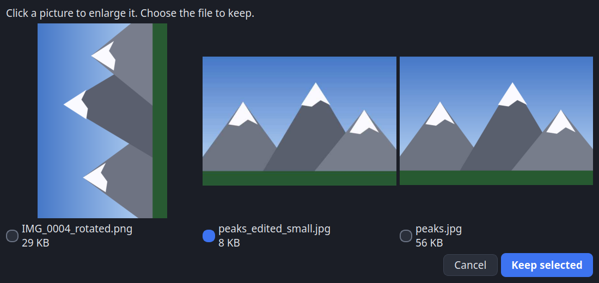
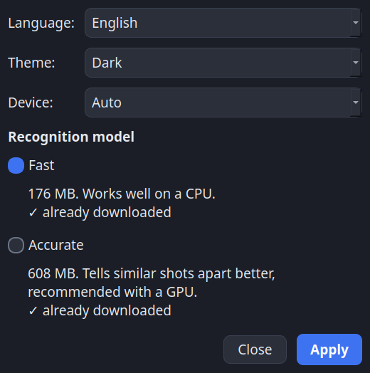

# AI Anti-Duplicate

**English** · [Русский](README.ru.md)

Free, open-source tool that finds duplicate photos by **what is in the picture**, not by file size, date or hash.
It uses the CLIP AI model, so it recognises the same shot even if it was resized, re-compressed, cropped a little or rotated.

> 🛡️ **Safe by design:** the app only *copies* files. It never deletes, moves or changes your originals.

## Screenshots
*(demo with generated pictures: three scenes each have copies — an edited small one and a rotated one — and two scenes are unique)*

## How it works
1. Choose the folder with your photos.
2. Choose the folder where unique photos will be saved.
3. Pick a rule for duplicates: **newest**, **largest file**, **highest resolution**, or **choose manually** for every shot (click any picture to enlarge it).
4. Press **Find duplicates and save**. You get every photo that has no duplicates, plus the best copy from each group of duplicates.

The interface is dark and available in English and Russian (language switcher in the top-right corner).

The **Sensitivity** slider controls how similar two photos must be: *Strict* finds only near-identical files, *Soft* also finds similar shots from the same scene.

## Settings (⚙ button)
- **Language:** English / Русский.
- **Theme:** dark, light or follow the system.
- **Model:** *Fast* (176 MB, works well on a CPU) or *Accurate* (608 MB, tells similar shots apart better, recommended with a GPU). The size of each download is shown before you choose. On the first launch no model is installed: the app asks you to pick one in Settings and then downloads it with a progress bar.
- **Device:** Auto / CPU / GPU. Auto uses the graphics card when available (DirectML on Windows, CoreML on macOS) and falls back to the CPU if anything goes wrong.

## Download (no installation of Python needed)
Get the file for your system from the [**Releases**](https://github.com/nikweel/ai-anti-duplicate/releases/latest) page:

| System | File | How to run |
|---|---|---|
| **Windows** | `…-Setup.exe` | Double-click, follow the installer. |
| **Linux (any)** | `….AppImage` | Right-click → Properties → *Allow executing as program*, then double-click. Or in a terminal: `chmod +x *.AppImage && ./*.AppImage` |
| **Linux (Ubuntu/Debian)** | `….deb` | Double-click → *Install*. The app appears in your menu. |
| **macOS** | `….dmg` | Open, drag the app to *Applications*. First launch: right-click → *Open* (the app is not signed). |

On the first launch you choose the AI model in Settings and the app downloads it once (needs internet). After that it works fully offline.

## Security warnings on first launch (this is normal)
The app is free and not code-signed (certificates cost money), so your system may warn you. The app is open source and only *copies* files; you can verify downloads with `SHA256SUMS.txt` from the release (`sha256sum -c SHA256SUMS.txt`).
- **Windows:** "Windows protected your PC" → click **More info → Run anyway**.
- **macOS:** open **System Settings → Privacy & Security**, scroll down and click **Open Anyway** next to the app (on older macOS: right-click the app → *Open*).
- **Linux:** no warnings. For AppImage just allow executing it (right-click → Properties → *Allow executing as program*).

## Run from source (portable, no manual setup)
Download the repository and double-click `start.cmd` (Windows), `start.command` (macOS) or `start.sh` (Linux).
The first run downloads Python and all dependencies into the local `runtime/` folder automatically.

## Development
- Model export: `scripts/export_onnx.py`, `scripts/shrink_onnx.py` (PyTorch → ONNX, fp16 weights; the result matches the original to within 0.0001 similarity).
- Build: `pyinstaller packaging.spec`; packages: `packaging/`; CI: `.github/workflows/build.yml` (push a tag `app-v*`).
- Tests: `pytest`.

Pull requests and ideas are welcome!

## License
[MIT](LICENSE) — free for any use, including commercial. Do whatever you like, just keep the copyright notice.
The CLIP model is by OpenAI (MIT).

## Author
Nikolay Fedotov — [tech-crm.ru](https://tech-crm.ru/) · [VK](https://vk.ru/id191178167) · [MAX](https://max.ru/u/f9LHodD0cOInyBtQrxPp6Z1O_g2V8Ck-1hzBxWg_l9EN48ubud67NUWeyTM) · [Facebook](https://www.facebook.com/nikweel) · [GitHub](https://github.com/nikweel)
