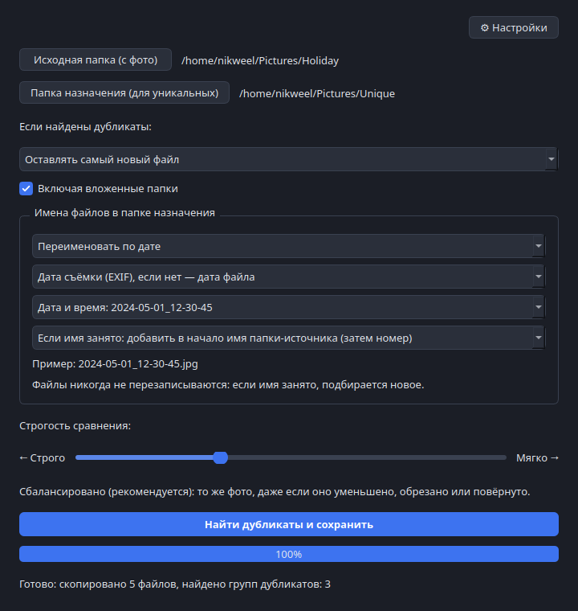
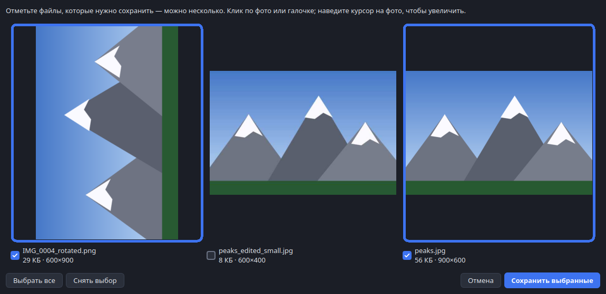
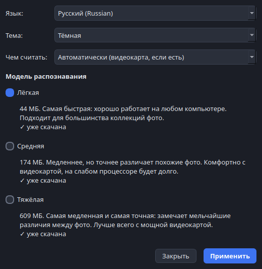

# Photo Duplicate Finder AI

[العربية](README.ar.md) · [Български](README.bg.md) · [中文（简体）](README.zh.md) · [繁體中文](README.zh-TW.md) · [Hrvatski](README.hr.md) · [Čeština](README.cs.md) · [Dansk](README.da.md) · [Nederlands](README.nl.md) · [English](README.md) · [Suomi](README.fi.md) · [Français](README.fr.md) · [Deutsch](README.de.md) · [Ελληνικά](README.el.md) · [हिन्दी](README.hi.md) · [Magyar](README.hu.md) · [Bahasa Indonesia](README.id.md) · [Italiano](README.it.md) · [日本語](README.ja.md) · [한국어](README.ko.md) · [Lietuvių](README.lt.md) · [Norsk](README.nb.md) · [Polski](README.pl.md) · [Português](README.pt.md) · [Română](README.ro.md) · **Русский** · [Slovenčina](README.sk.md) · [Español](README.es.md) · [Svenska](README.sv.md) · [Türkçe](README.tr.md) · [Українська](README.uk.md)

**Photo Duplicate Finder AI** — бесплатная программа с открытым кодом для поиска дубликатов **фотографий** (JPG, PNG, WebP) по **содержимому кадра**, а не по размеру, дате или md5.
Работает на ИИ (DINOv2), поэтому узнаёт один и тот же снимок, даже если он уменьшен, пересжат, слегка обрезан или повёрнут.
Предназначена только для коллекций фото; это не универсальный поиск дубликатов документов, видео или других файлов.

> 🛡️ **Безопасно:** программа только *копирует* файлы. Она никогда ничего не удаляет, не перемещает и не меняет в ваших оригиналах.

## Скриншоты
*(демо на сгенерированных картинках: у трёх сцен есть копии — уменьшенная и повёрнутая, ещё две сцены уникальны)*

## Как пользоваться
1. Выберите папку с фотографиями.
2. Выберите папку, куда сохранить уникальные фото.
3. Выберите правило для дублей: **самый новый**, **самый тяжёлый**, **самый большой по разрешению** или **вручную** для каждого кадра (отметьте один или несколько файлов; наведите на фото, чтобы увеличить).
4. Нажмите **«Найти дубликаты и сохранить»**. В папку попадут все фото без дублей и по одному лучшему из каждой группы дублей.

Интерфейс тёмный, есть выбор языка (русский/English) в правом верхнем углу.

Ползунок **«Чувствительность»**: влево — «строго» (только почти одинаковые файлы), вправо — «мягко» (найдёт и просто похожие кадры одной сцены).

## Ручной просмотр дублей
Выберите **«Выбирать вручную для каждого кадра»**, и программа покажет каждую группу дублей в отдельном окне:
- Все галочки сначала **сняты**: отметьте **все файлы, которые нужно сохранить** (один, несколько или все). Это нужно, если пара найдена по ошибке, например поза одна, а выражение лица другое.
- **Клик по фото** (или по галочке) выбирает его, выбранные фото обводятся синей рамкой.
- **Наведите курсор на фото**, чтобы увидеть его крупно, с именем, разрешением и размером.
- Кнопки «Выбрать все» / «Снять выбор»; кнопка «Сохранить выбранные» неактивна, пока не отмечен хотя бы один файл.

## Имена файлов при копировании
Программа ищет во **всех вложенных папках** (отключается флажком «Искать во вложенных папках») и **никогда не перезаписывает и не теряет файлы**. Всё настраивается до нажатия кнопки:
- **Оставить имена как есть** или **переименовать по дате**.
- **Источник даты:** дата съёмки (EXIF, если её нет — дата файла), дата создания файла или дата изменения. *(В Linux многие файловые системы не хранят дату создания, тогда берётся дата изменения.)*
- **Формат даты:** `2024-05-01_12-30-45`, `20240501_123045`, **timestamp** Unix (секунды или миллисекунды) или свой шаблон (`%Y %m %d %H %M %S`, `{ts}`, `{ms}`).
- **При совпадении имён:** добавить номер (`IMG_0001_1.jpg`) или префикс с именем папки-источника (`Holiday_IMG_0001.jpg`, а если и оно занято — ещё номер). Если в папке назначения уже лежит файл с точно таким же содержимым, он пропускается, поэтому программу можно безопасно запускать повторно.

Список «что куда скопировано» сохраняется в `data/logs/last_export.csv`.

## Настройки (кнопка ⚙)
- **Язык:** 30 языков (список отсортирован по алфавиту английских названий, каждый язык подписан на своём языке): арабский, болгарский, китайский (упрощённый и традиционный), хорватский, чешский, датский, нидерландский, английский, финский, французский, немецкий, греческий, хинди, венгерский, индонезийский, итальянский, японский, корейский, литовский, норвежский, польский, португальский, румынский, русский, словацкий, испанский, шведский, турецкий, украинский (арабский отображается справа налево). При первом запуске язык определяется по системе.
- **Тема:** тёмная, светлая или как в системе.
- **Модель распознавания** (размер загрузки показан до выбора):

  | Модель | Размер | Для чего |
  |---|---|---|
  | **Лёгкая** | 44 МБ | Самая быстрая, хорошо работает на любом компьютере. Подходит для большинства коллекций фото. |
  | **Средняя** | 174 МБ | Медленнее, точнее различает похожие фото. Комфортно с видеокартой. |
  | **Тяжёлая** | 609 МБ | Самая медленная и самая точная: замечает мельчайшие различия. Лучше всего с мощной видеокартой. |

  При первом запуске модели нет: программа просит выбрать её в настройках и скачивает с полосой прогресса. Внутри это модели [DINOv2](https://github.com/facebookresearch/dinov2) (Apache 2.0) в формате ONNX; в наших замерах они лучше CLIP отличают настоящие дубли от просто похожих фото и при этом намного меньше.
- **Чем считать:** автоматически / процессор / видеокарта. «Автоматически» использует видеокарту, если она есть (DirectML на Windows, CoreML на macOS), и при любой проблеме переходит на процессор.
- **Строгость сравнения** (ползунок на главном окне): «Строго» находит только практически одинаковые фото, «Мягко» — и просто похожие. Положение по умолчанию подобрано отдельно для каждой модели.

## Скачать (устанавливать Python не нужно)
Выберите файл для своей системы на странице [**Releases**](https://github.com/nikweel/photo-duplicate-finder-ai/releases/latest):

| Система | Файл | Как запустить |
|---|---|---|
| **Windows** | `…-Setup.exe` | Двойной клик, следуйте установщику. |
| **Linux (любой)** | `….AppImage` | Правый клик → Свойства → «Разрешить выполнение как программу», затем двойной клик. Или в терминале: `chmod +x *.AppImage && ./*.AppImage` |
| **Linux (Ubuntu/Debian)** | `….deb` | Двойной клик → «Установить». Программа появится в меню приложений. |
| **macOS** | `….dmg` | Откройте, перетащите программу в «Программы». Первый запуск: правый клик → «Открыть» (программа не подписана). |

При первом запуске вы выбираете ИИ-модель в настройках, и программа один раз её скачивает (нужен интернет). Дальше работает полностью офлайн.

## Предупреждения системы при первом запуске (это нормально)
Программа бесплатная и не подписана сертификатом (они платные), поэтому система может предупредить. Код открыт, программа только *копирует* файлы; скачанное можно проверить по `SHA256SUMS.txt` из release (`sha256sum -c SHA256SUMS.txt`).
- **Windows:** «Windows защитила ваш компьютер» → **Подробнее → Выполнить в любом случае**.
- **macOS:** **Системные настройки → Конфиденциальность и безопасность**, прокрутите вниз и нажмите **«Всё равно открыть»** у программы (на старых macOS: правый клик по программе → «Открыть»).
- **Linux:** предупреждений нет. Для AppImage достаточно разрешить запуск (правый клик → Свойства → «Разрешить выполнение как программу»).

## Как выбирались модели
Мы сравнили модели на реальных фото: настоящие дубли (уменьшенные, пересжатые, обрезанные, с изменённой яркостью) против *трудных негативов* — того же фото с заменённой частью картинки (имитация «та же поза, другое выражение»). Оценка — AUC различения этих двух групп (1,0 = идеально); скорость измерена на процессоре.

| Модель | Размер | AUC | Скорость на фото |
|---|---|---|---|
| CLIP ViT-B/32 | 176 МБ | 0,836 | ~22 мс |
| CLIP ViT-L/14 | 608 МБ | 0,875 | ~325 мс |
| **DINOv2 small (Лёгкая)** | 44 МБ | 0,889 | ~37 мс |
| **DINOv2 base (Средняя)** | 174 МБ | 0,894 | ~102 мс |
| **DINOv2 large (Тяжёлая)** | 609 МБ | 0,909 | ~330 мс |

Выборка небольшая (около 40 фото с одного компьютера), поэтому цифры показывают тенденцию, а не гарантию. Скрипты: `scripts/export_dinov2.py`, `scripts/shrink_onnx.py`.

## Запуск из исходников (портативно, без ручной установки)
Скачайте репозиторий и дважды кликните `start.cmd` (Windows), `start.command` (macOS) или `start.sh` (Linux).
Первый запуск сам скачает Python и все зависимости в папку `runtime/`.

## Разработка
- Экспорт модели: `scripts/export_dinov2.py` (PyTorch → ONNX) и `scripts/shrink_onnx.py` (веса fp16; результат совпадает с оригиналом с точностью до 0,0003 по сходству). Файлы моделей раздаются из релиза `v0.1` и после загрузки проверяются по точному размеру.
- Сборка: `pyinstaller packaging.spec`; пакеты: `packaging/`; CI: `.github/workflows/build.yml` (отправьте тег `app-v*`).
- Тесты: `pytest`.

Идеи и pull request'ы приветствуются!

## Лицензия
[MIT](LICENSE) — бесплатно для любого использования, в том числе коммерческого. Делайте что хотите, только сохраняйте упоминание автора.
Модели — DINOv2 от Meta AI (Apache 2.0).

## Автор
Николай Федотов — [tech-crm.ru](https://tech-crm.ru/) · [VK](https://vk.ru/id191178167) · [MAX](https://max.ru/u/f9LHodD0cOInyBtQrxPp6Z1O_g2V8Ck-1hzBxWg_l9EN48ubud67NUWeyTM) · [Facebook](https://www.facebook.com/nikweel) · [GitHub](https://github.com/nikweel)
